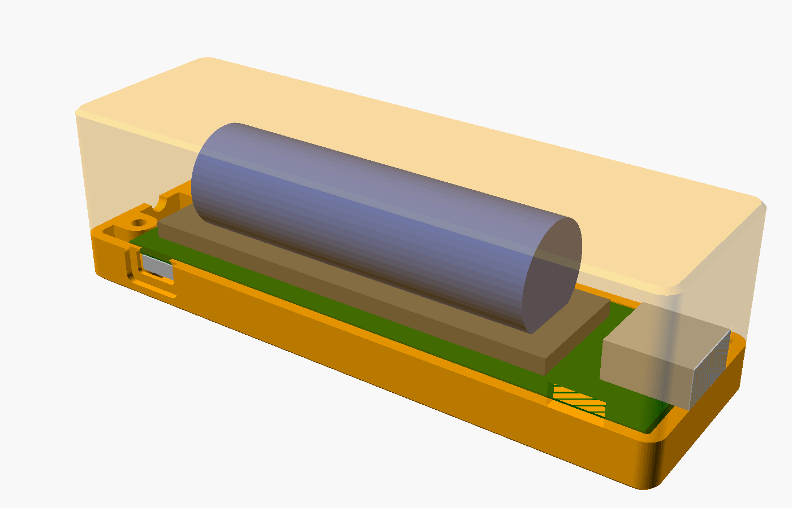
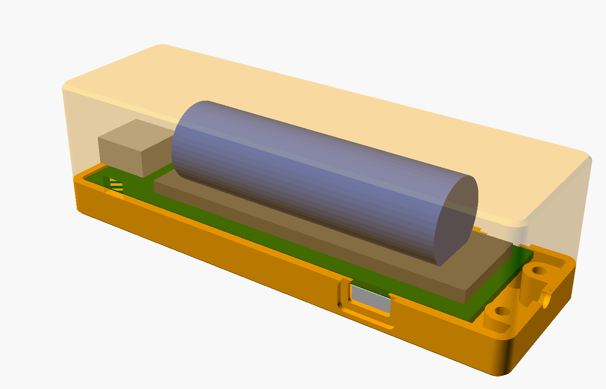

# PETG case for an 18650 battery shield (USB-A out, USB-C / micro-USB in)

A two-part case for the common single-18650 "battery shield" board: USB-A output,
USB-C and micro-USB charge inputs, a slide switch, a push button, and 5 V / 3 V header pads.
Use it as a small USB power bank or as a power source for an ESP32.

| File | What it is |
|---|---|
| `case.scad` | Parametric OpenSCAD source. All dimensions are at the top. |
| `stl/tray.stl` | Bottom part that holds the PCB, ready to print |
| `stl/lid.stl` | Top part that covers the battery, already flipped onto its roof for printing |
| `stl/plate.stl` | Both parts on one plate |
| `step/*.step` | STEP solids for Onshape / Fusion / FreeCAD (see below) |
| `case_step.py` | CadQuery script that generates the STEP files |

Outside size with the default settings: **111 × 34.3 × 32.5 mm**.

## Design

- **Split at the top surface of the PCB.** The board drops into the tray. The lid slides
  down over it. Every opening is a notch that's open at the seam, so assembly works even
  when the switch, button and connectors stick out past the edge of the board.
- **The tray** has the USB-C opening (front edge) and the micro-USB opening (back edge),
  because both connectors are on the underside. It also has 5 LED windows under the
  charge/level LEDs, floor vents under the boost converter, and standoffs.
- **The lid** has the USB-A opening at the end, the slide-switch window (back edge) and
  the push-button window (front edge). The button and switch stick out about 2–3 mm past
  the board, which puts them roughly flush with the outside of the case.
- **Plug pockets:** the outside of the case is recessed around the USB-C and micro-USB
  openings so cable plugs seat fully.
- **4 screws from underneath:** 2 go through the PCB's mounting holes at the USB-A end
  into lid posts, and 2 go into bosses in a 7 mm "end bay" past the battery end. Two
  blocks in the lid press the battery end of the PCB down.
- **Cable exit:** there's a Ø4 mm hole in the battery-end wall, split across the seam. Run
  a 2-wire lead from the 5 V or 3 V pads to an ESP32 through it. The seam clamps the wire
  so it can't pull out. Turn it off with `wire_exit = false`.
- Optional: `mount_ears = true` adds screw tabs on both ends.

## ⚠️ Measure before you print

I estimated the defaults from your photos, so treat them as starting points. Open
`case.scad` in OpenSCAD, measure with calipers, and edit every value marked `<-- MEASURE`.
The ones that matter most:

| Parameter | What to measure |
|---|---|
| `board_l`, `board_w` | Bare PCB size (default 99 × 29.5) |
| `bottom_clear` | Tallest part on the **underside** (inductor / USB-C) + 0.5 mm |
| `top_clear` | PCB top to the top of the inserted 18650 + 1 mm |
| `hole_inset_x/y` | Centre of the corner mounting holes, measured from the end and side of the PCB |
| `usba_overhang` | How far the USB-A shell sticks out past the PCB end |
| `usbc_x`, `micro_x`, `btn_x`, `sw_x`, `led_x` | Centre of each part, measured **from the USB-A end** of the PCB |

`x` is measured along the board from the USB-A end. `y` is measured across the board from
the **front** edge, which is the edge with the button and the USB-C port. The switch and
micro-USB are on the back edge.

Tip: print `tray.stl` on its own first (about 1 hour) and test-fit the board before you
print the lid.

To export after editing: `openscad -o tray.stl -D 'part="tray"' case.scad` (or `lid` /
`plate`). Use `part="assembly"` to preview the case with stand-in parts.

## Editing in Onshape (or Fusion 360 / FreeCAD)

Use the **STEP** files in `step/`, not the STLs. STL is a triangle mesh, and Onshape can't
edit a mesh as a solid. STEP gives you real faces, holes and fillets.

| File | Use |
|---|---|
| `step/case_assembled.step` | **Start here.** Tray + lid as two separate parts, in assembled position |
| `step/tray.step`, `step/lid.step` | Each part on its own |

1. In Onshape, go to **Create → Import** (or drag the file in) and pick
   `case_assembled.step`.
2. Open the Part Studio that the import creates. You'll get two parts, *tray* and *lid*,
   and you can edit them with:
   - **Move face** (and Offset face): widen or shift a port opening, change wall
     thickness or height, move a screw post. This is the most useful tool for imported parts.
   - **Delete face**: remove a feature completely, e.g. select the faces of the vents or
     LED holes and delete them so the floor heals over.
   - Sketch on any face, then **Extrude** to add or remove material (new holes, text,
     mounting tabs, an ESP32 bay). **Fillet / Chamfer** work on any edge.
3. Export each part as STL (right-click the part → Export) and slice as usual. Flip the
   lid onto its roof for printing.

Imported STEP files have **no feature history**, so you can't change a number and have
everything update. For big parametric changes (different board size, taller battery),
edit the values at the top of `case_step.py` (they match `case.scad`), run
`pip install cadquery && python3 case_step.py`, and re-import the new STEP.

## Print settings (PETG)

- Nozzle 230–245 °C, bed 70–80 °C, 0.2 mm layers
- 3–4 perimeters, 20–25 % gyroid infill
- **No supports needed.** Print the tray floor-down and the lid roof-down (that's how the
  STLs are oriented).
- Use a glue stick or textured PEI on smooth PEI, because PETG can stick too hard.
- PETG softens at about 80 °C. That's fine for a 3 A boost converter, but don't leave the
  case on a car dashboard.

## Hardware

- 4 × **M2.5 × 12–16 mm** self-tapping or machine screws, threaded straight into the PETG
  pilot holes. For M3, set `screw = "M3"`, but check first that an M3 fits your board's
  mounting holes; they're often only ~2.7 mm.
- Optional: 4 small rubber feet.

## Assembly

1. Insert the 18650 and check that the board works.
2. Drop the board into the tray with the USB-A end at the end that has the cone-shaped
   standoffs. The USB-C and micro-USB connectors line up with their notches.
3. If you're powering an ESP32 from the pads, solder a lead to the 5 V or 3 V pads, run it
   along the side of the battery holder, and out through the cable hole.
4. Fit the lid and screw it down from underneath. Don't overtighten the screws into the
   plastic.

## ESP32 notes

- These boards use a power-bank chip that **turns its 5 V output off when the load is very
  small**, typically under about 50 mA for roughly 30 s. An ESP32 in deep sleep draws less
  than that, so the 5 V output may switch off and won't come back until you press the
  button. Fixes:
  - Use the **3 V header pads** instead. On most versions of this board they come from LDOs
    fed by the battery side and stay on. Check yours with a multimeter while drawing only a
    few mA.
  - Or keep the ESP32 awake / use light sleep. The ESP32 alone draws more than the cutoff.
- When feeding 3.3 V into an ESP32 dev board, connect it to the **3V3 pin**, not VIN/5V.
- The LEDs are on the underside of the board, so the charge/level indicator shows through
  the windows in the bottom of the case.
